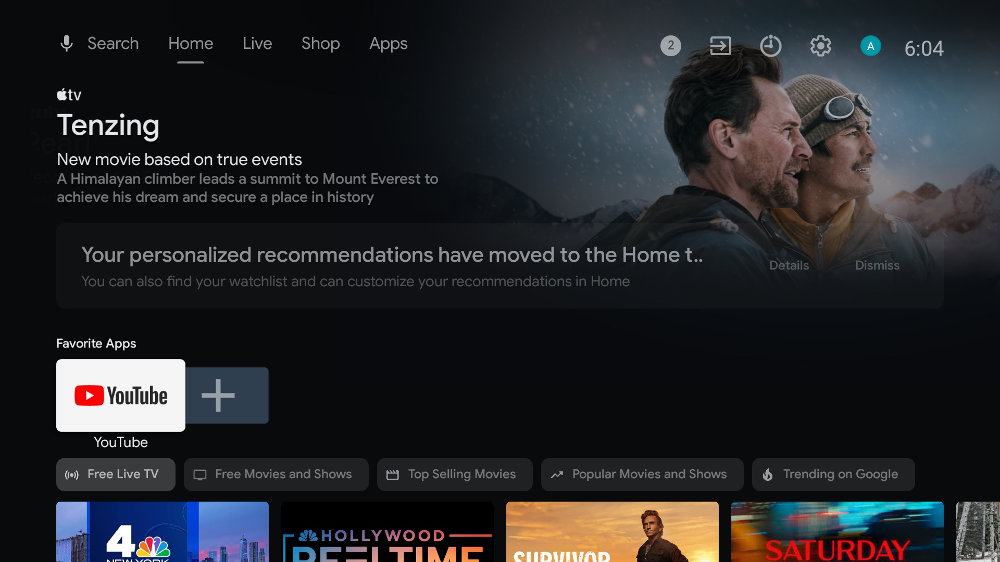
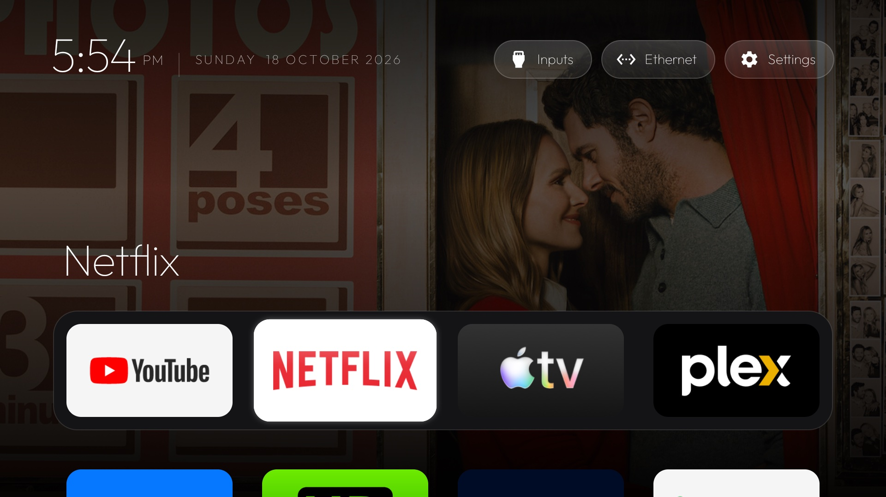
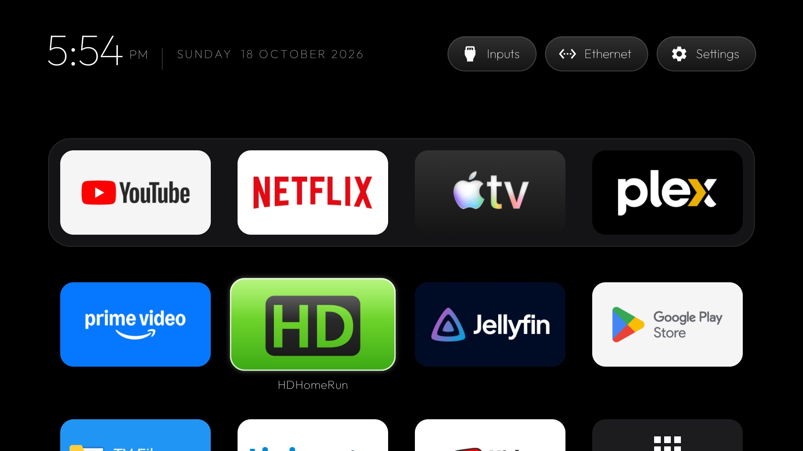

# Vibe Launcher

A fork of [Gathin23/tv-vibehack](https://github.com/Gathin23/tv-vibehack), developed further into a
daily-driver home screen (**Vibe Launcher**) and tested on Sony Bravia TVs and the NVIDIA Shield.

**Your TV, minus the ads.** Debloat any Android TV / Google TV over ADB and give it a clean,
tvOS-inspired launcher. Hand the prompt to Claude Code or any coding assistant, answer a few
questions about which apps you use, and it does the rest on the real TV.

| Stock home screen | After |
|---|---|
|  |  |

Everything is reversible: packages are disabled, never uninstalled, and a restore script puts the
stock launcher back.

## Quick start

1. On the TV: Settings → Device Preferences → About → press OK on **Build** seven times → back →
   Developer options → turn on **USB debugging** (and Network/ADB debugging if your TV shows it).
   Keep the TV on and on the same Wi-Fi as your computer.
2. Open Claude Code (or your assistant of choice) on your computer and paste the prompt from
   [`PROMPT.md`](PROMPT.md), filling in your TV model.
3. Accept the "Allow USB debugging?" prompt on the TV when told to, then answer the checklist
   questions (which apps you use, which four go in the dock).

That's it. The assistant backs up, debloats, builds and installs the launcher, and verifies each
step with screenshots from the TV. If you'd rather do it by hand, the pieces are below.

## What's in the repo

| Path | What it is |
|---|---|
| [`PROMPT.md`](PROMPT.md) | The prompt. Brand-neutral; the assistant discovers your TV's bloat. |
| [`launcher/`](launcher/) | The tvOS-style launcher. Edit `app/src/main/res/values/config.xml` for your dock, hidden apps and Live TV package, then run `build-and-install.sh`. |
| [`tools/tv.py`](tools/tv.py) | Pure-Python ADB client (shell, batch, push, pull). Works where the stock `adb` is blocked. |
| [`tools/b64push.py`](tools/b64push.py) | Uploads larger files (APKs) as base64 chunks with an md5 check. |
| [`tools/disable.sh`](tools/disable.sh), [`tools/restore.sh`](tools/restore.sh) | Apply or undo a debloat list. |
| [`examples/`](examples/) | Per-TV debloat lists. Add yours, see [CONTRIBUTING.md](CONTRIBUTING.md). |

## The launcher

**Vibe Launcher** (`com.maydings.vibelauncher`) is a small native Android TV home screen built for sets
with 1 GB of RAM. It runs on Android 8.0+ and targets API 34, so Play Protect lets you install it on
Android 11+ devices such as the Shield.



**Home screen**

- Pitch-black background, like Apple TV 4K.
- A dock at the bottom in a lighter rounded band with the four apps you choose. The shelf above
  shows the focused dock app's name in large type.
- **Backdrops.** Big streaming apps (YouTube, Netflix, Apple TV, Plex, Paramount+, Prime Video,
  Peacock) get a sharp still from their public pages behind the dock, darkened as if behind tinted
  glass so text stays legible. No accounts or API keys are needed. Stills are cached on disk,
  refreshed daily and change each visit. Other apps get an ambient glow sampled from their icon.
- Press Down and the dock slides up to reveal the rest of your apps in a grid.
- **Frosted top bar.** Tiles that scroll under the bar are shown blurred and tinted. It is drawn in
  software because Android 9 has no live blur, and is flicker-free on Android 9 through 11+.
- Clock and full date (weekday, day, month, year) top left, set in
  [Outfit](https://fonts.google.com/specimen/Outfit).

**Navigation**

- One translucent glass highlight springs from tile to tile. The focused tile lifts and shows its
  name.
- Vertical moves plan the scroll first so the highlight glides straight to its target without
  overshooting. Up/down plays the same click as left/right.
- Deterministic D-pad navigation. Left and right stop at the ends of a row instead of escaping to
  the top bar. The last focused tile is remembered, and tiles enter with a staggered animation.

**Managing apps**

- Long-press OK on a tile for **Move** (rearrange with the D-pad, into and out of the dock),
  **Remove** (hide from Home or uninstall), **App info** and **Show hidden apps**. Order and hidden
  apps are saved.
- An **All apps** tile at the end of the grid opens Settings › Apps.

**Top bar pills**

- **Inputs:** a dropdown of HDMI ports, AV and Live TV. It is hidden automatically on devices with
  no inputs, such as the Shield.
- **Network:** shows the network name. The dropdown lists the device name and model (handy with
  several TVs), then each interface with its IPv4 address.
- **Settings.**

**Safety net**

- If the launcher crashes twice within two minutes, it opens App info for Google's stock TV launcher
  so one press of Enable restores a working home screen.

Configure it in [`launcher/app/src/main/res/values/config.xml`](launcher/app/src/main/res/values/config.xml):
dock order, hidden apps, Live TV package and columns. Build and install with

```bash
TV_HOST=192.168.1.50 launcher/build-and-install.sh
```

Needs JDK 17 and the Android SDK (platform 34, build-tools 34.0.0). On macOS:
`brew install openjdk@17 android-commandlinetools && sdkmanager "platforms;android-34" "build-tools;34.0.0"`.

## Talking to the TV by hand

```bash
python3 -m venv tools/venv && tools/venv/bin/pip install -r tools/requirements.txt
export TV_HOST=192.168.1.50                                   # your TV's IP
tools/venv/bin/python -I tools/tv.py --probe                 # model, Android version, firmware
tools/venv/bin/python -I tools/tv.py 'pm list packages'      # one command
printf 'cmd1\ncmd2\n' | tools/venv/bin/python -I tools/tv.py --batch
tools/disable.sh examples/xiaomi-mi-tv-4a/debloat.txt        # apply a list
tools/restore.sh examples/xiaomi-mi-tv-4a/debloat.txt        # undo it, restore stock launcher
```

### Gotchas we hit

- **macOS: `adb connect` says "No route to host"** while the port is clearly open. Recent macOS
  treats the Google-signed `adb` as its own app under Local Network privacy and silently blocks it.
  `tools/tv.py` avoids the binary entirely.
- **No "wireless debugging" toggle** on some TVs (Xiaomi among them). USB debugging alone opens
  network ADB on port 5555.
- **Chained `pm` commands** (`pm disable a; pm disable b`) may silently stop after the first. Run
  one per shell call; `--batch` does this.
- **Large pushes hang** through the Python client. Use `tools/b64push.py` for APKs.
- **Disable the stock launcher only after the new one is installed**, or the Home button lands on
  a factory test app.
- **Third-party launchers** often charge for basics like a custom wallpaper. Hence `launcher/`.
- **No on-screen keyboard** after switching launchers (seen on Xiaomi): the default input method
  pointed at a Baidu IME that isn't installed. Fix with
  `tools/tv.py 'ime set com.google.android.inputmethod.latin/com.android.inputmethod.latin.LatinIME'`.

## Supported TVs

Anything running Android TV or Google TV: Xiaomi/Redmi, TCL, Hisense, Sony, OnePlus, Realme,
Nvidia Shield and most others. Not Samsung Tizen, LG webOS or Amazon Fire TV (different OS, no ADB
launcher replacement).

Tested so far:

| Device | Android |
|---|---|
| Sony Bravia XBR-940E | 9 |
| Sony Bravia 900F | 9 |
| NVIDIA Shield TV (2017) | 11 |
| Xiaomi Mi TV 4A (see [`examples/`](examples/)) | 10 |

## Contributing

Add your TV's debloat list, improve the launcher, or sharpen the prompt. See
[CONTRIBUTING.md](CONTRIBUTING.md).

## Licence

MIT, see [`LICENSE`](LICENSE). The Outfit typeface is under the SIL Open Font License, see
`launcher/FONT-LICENSE-OFL.txt`.
