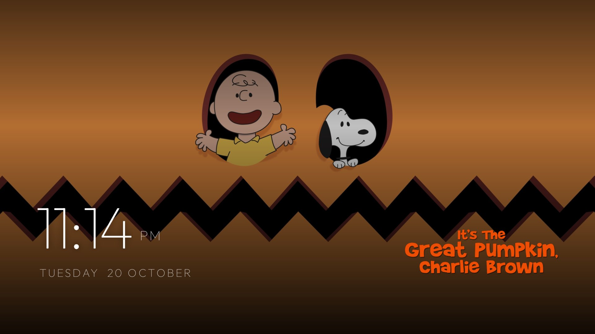
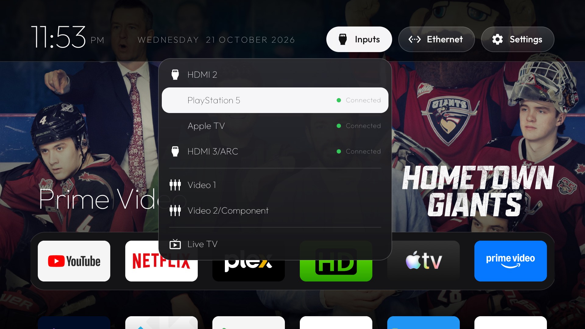
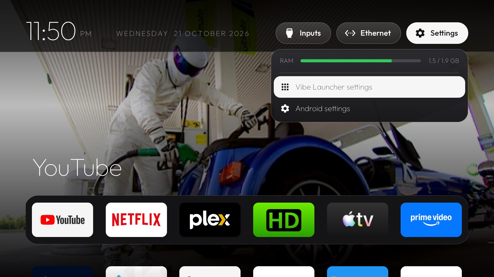
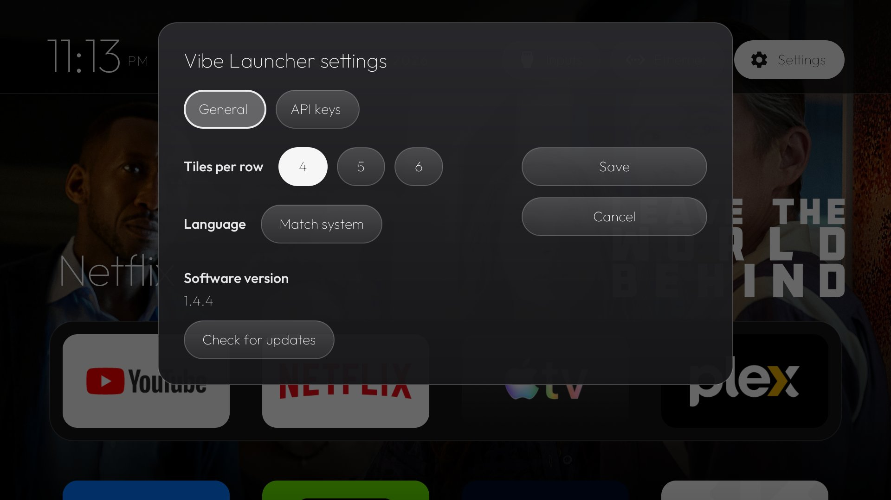
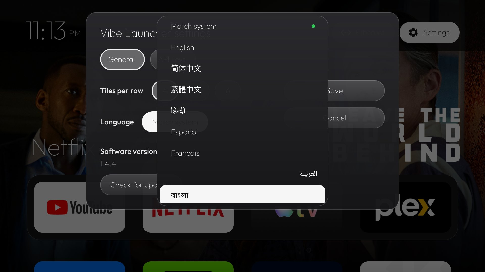
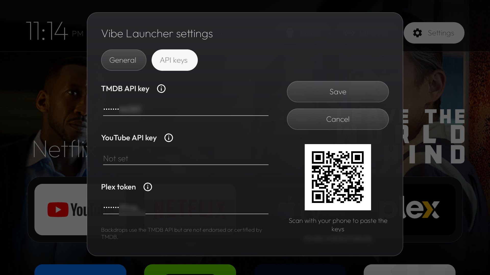
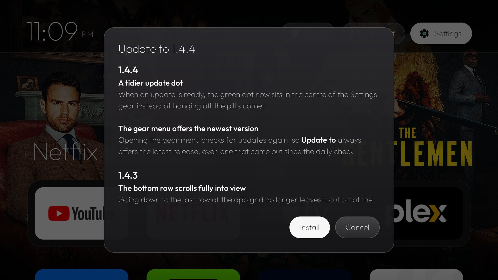

# Vibe Launcher

**A clean, snappy home screen for Android TV.** Your favourite apps in a dock, full-screen artwork from
what they're offering you, and nothing else: **no ads, no data collection**, no sponsored rows, no
accounts. Free and open source.

I built Vibe Launcher for my own TVs at home, because I wanted a home screen that just shows my apps
and gets out of the way. It works well enough for us that I'd like to share it with everyone else.


**[Download the latest APK](https://github.com/maydings/vibe-launcher/releases/latest/download/vibe-launcher.apk)**
· Android TV and Google TV, Android 8.0 or newer · about 2 MB

## Highlights

- **Backdrops from your apps.** The focused app fills the screen with what it's actually showing you:
  the film or show on its home screen card, with the title's own logo.
- **Dock and grid.** Up to six favourite apps in a dock; press Down for everything else.
- **Inputs at a glance.** HDMI ports with what's connected, devices behind a switch listed by name.
- **A screensaver to match.** Your backdrops, full screen, with a large clock.
- **50 languages.** Follows your TV, or pick one.
- **Updates itself.** Shows what's new, checks the download, installs with one confirmation.
- **Snappy and light.** Moving around feels instant, even on older TVs with 1 to 2 GB of RAM; no
  background services.

## The home screen

Your favourite apps sit in a dock at the bottom of the screen: four by default, five or six if you
like. Press Down and the rest of your apps slide up in a grid. A single glass highlight springs from
tile to tile.


### Backdrops

As you move along the dock, the screen behind it fills with artwork from the focused app:

- **The apps' own home screen cards** (Netflix, Apple TV, Prime Video, Jellyfin and others): the film
  or show each one is offering, shown as a clean full-size backdrop with the title's logo instead of
  the app's own art and stickers. Works out of the box, using Stremio's free film data.
- **TMDB** for the most reliable artwork, with a free API key.
- **YouTube**: your own feed through [SmartTube](https://github.com/yuliskov/SmartTube), which
  Settings can install for you; or the most popular videos in your country with a YouTube API key;
  or, with neither, trailers of the films everyone's watching.
- **Plex**: Continue Watching and recently added from your own server, with your Plex token.
- **HDHomeRun**: what's on your tuner right now, from SiliconDust's free guide. No setup.

Low-resolution art becomes a 2×2 wall instead of one blurry still, and apps with nothing to show get
a soft glow in their own colour.

### Screensaver

**Vibe Launcher posters** shows the same backdrops full screen, slowly drifting and cross-fading,
with a large clock and each title's logo. It uses only pictures already on the TV. Choose it in your
TV's screen saver settings (on Android TV: Settings → Device Preferences → Screen saver).



## The top bar

A frosted bar with the clock and date, and three menus. Left and Right move between them.

- **Inputs** lists every HDMI and AV input with whether something is connected, plus Live TV. Devices
  that announce themselves over HDMI-CEC appear by name under their port, so an Apple TV and a
  PlayStation behind an HDMI switch each get their own row. Names and hidden inputs from the TV's own
  settings carry over.
- **Network** shows each connection with its IP address (and the Wi-Fi link speed), and VPNs.
- **Settings** shows live memory use and opens Vibe Launcher's settings or Android's.

|  |  |
|---|---|

## Settings

**General**: tiles per row, hiding inactive inputs, language and the software version.

|  |  |
|---|---|

- **Tiles per row**: 4, 5 or 6. Tiles shrink to fit and the dock holds as many apps.
- **Hide inactive inputs**: the Inputs menu lists only what's connected.
- **Language**: Match system (the default), or any of 50 languages, each listed in its own name. The
  clock and date follow it.

**API keys**: optional keys that unlock more backdrops: **TMDB**, **YouTube** and **Plex**. Each has
an ⓘ that explains what it adds and where to get it, free. Typing a 32-character key with a remote
is no fun, so the tab shows a **QR code**: scan it with your phone and paste the keys there. Saved
keys stay on the TV and show only their last four characters. Under YouTube, one button installs
SmartTube (its latest release, checked against GitHub's checksum) or opens it to sign in.



## Updates

Vibe Launcher checks for new versions once a day, and whenever you open the Settings menu. When one is
out, a green dot appears in the Settings gear and the menu offers **Update to** it. You see what's
new in every version since yours, then **Install**: the download is checked against the release's
SHA-256 before Android asks you to confirm, and Home comes back by itself afterwards.



## Managing apps

Long-press OK on any tile to **move** it (into or out of the dock), **hide** it, **uninstall** it or
open **App info**. Hidden apps come back from the same menu.

## Install

Download **[vibe-launcher.apk](https://github.com/maydings/vibe-launcher/releases/latest/download/vibe-launcher.apk)**
and install it. No account needed.

### On the TV

1. Install a downloader or file manager from the Play Store, for example **Downloader** (by
   AFTVnews) or **X-plore**.
2. Open the download link above in it and open the APK. Android asks once to allow that app to install
   apps; allow it.
3. Open Vibe Launcher from your apps and allow its two permissions: TV listings (for the apps'
   cards) and location (Android only reveals the Wi-Fi network's name with it).
4. Make it your home screen when it offers to, or later from the Settings menu → **Make Vibe Launcher
   your Home**.

### Keeping it as your home screen

Google's own launcher and Google's setup app are system apps that can keep answering the Home button,
even with Vibe Launcher set as the default. Turning them off takes a computer with
[adb](https://developer.android.com/tools/adb), once:

```bash
adb connect <tv-ip>:5555
adb install -g vibe-launcher.apk
adb shell am start -n com.maydings.vibelauncher/.MainActivity
# Google's launcher (on Google TV: com.google.android.apps.tv.launcherx) and setup app
adb shell pm disable-user --user 0 com.google.android.tvlauncher
adb shell pm disable-user --user 0 com.google.android.tungsten.setupwraith
# Last: Android forgets the chosen Home whenever one is turned on or off
adb shell cmd package set-home-activity com.maydings.vibelauncher/.MainActivity
```

Two things to check before turning off the setup app:

- **Wi-Fi**: a network saved during the TV's first-time setup belongs to the setup app and goes with
  it. If `adb shell dumpsys wifi | grep -o 'cname=[^ ]*'` names setupwraith, forget the network and
  join it again in Settings first (or use Ethernet).
- **Casting**: on some Google TVs, casting from a phone needs the setup app. If you cast, leave it on.

To undo either, `adb shell pm enable --user 0 <package>`.

**Removing the TV's ads and bloat** is a separate job, and this project only replaces the home
screen. For that, see [Gathin23/tv-vibehack](https://github.com/Gathin23/tv-vibehack), with tested
lists for over a hundred TV models.

## Tested on

| Device | Android |
|---|---|
| Sony Bravia XBR-940E | 9 |
| Sony Bravia 900F | 9 |
| NVIDIA Shield TV (2017) | 11 |

It should run on any Android TV or Google TV with Android 8.0 or newer.

## Privacy

**No data collection and no ads, ever.** No accounts, no analytics, no tracking, and nothing is ever
sent to me. Vibe Launcher goes online only to fetch artwork (looking up the titles on your apps' cards
with TMDB or Stremio, and asking YouTube, your own Plex server or your HDHomeRun's guide) and to check
this project's releases for updates. Your API keys stay on the TV.

## Build it yourself

The source, a build script and how the backdrops work are in
[`vibe-launcher/`](vibe-launcher/README.md). Contributions are welcome, including corrections to the
machine-made translations (`vibe-launcher/app/src/main/res/values-*/strings.xml`).

## Licence

MIT, see [`LICENSE`](LICENSE). Started as a fork of
[Gathin23/tv-vibehack](https://github.com/Gathin23/tv-vibehack). The Outfit typeface is under the SIL
Open Font License (`vibe-launcher/FONT-LICENSE-OFL.txt`). Backdrops use the TMDB API but are not
endorsed or certified by TMDB.
