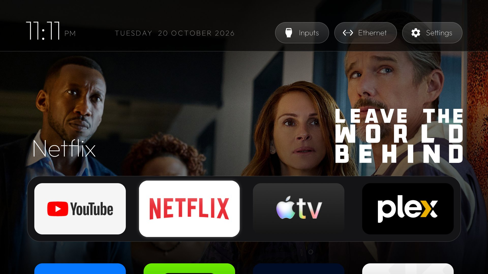

# Vibe Launcher

A free and open-source (MIT), tvOS-inspired home screen for Android TV, with no ads, ever. Plain
Java, about 2 MB, no background services; built for TVs with 1 to 2 GB of RAM. Android 8.0 (API 26) and newer, targets API 34 so Play Protect accepts it
on Android 11+ devices such as the NVIDIA Shield.



For what it does and how to install the ready-built APK, see the [main README](../README.md). This
page covers configuring, building and how the backdrops work.

## Configure

[`app/src/main/res/values/config.xml`](app/src/main/res/values/config.xml):

| Setting | What it does |
|---|---|
| `dock_apps` | Package names for the dock, in order. Missing apps are skipped. Can also be changed on the TV with long-press → Move. |
| `hidden_apps` | Packages never shown as tiles (e.g. the Live TV app, which the Inputs menu already offers). |
| `live_tv_package` | The TV's tuner app, offered at the end of the Inputs menu. Empty to omit. |
| `columns` | Default tiles per row (the dock has this many slots). On the TV, Vibe Launcher settings offers 4, 5 or 6, which overrides it. |

## Build

Needs JDK 17 and the Android SDK (platform 34, build-tools 34.0.0). On macOS:

```bash
brew install openjdk@17 android-commandlinetools
sdkmanager "platforms;android-34" "build-tools;34.0.0"
```

Build, install on the TV and make it the home screen in one go. It uses adb, or the Python ADB
client in [`tools/`](tools/) where macOS blocks adb on the local network:

```bash
./build-and-install.sh 192.168.1.50
```

Or by hand: `./gradlew assembleDebug`, then `adb install -r -g app/build/outputs/apk/debug/app-debug.apk`.

**Release builds** are signed with a key that never enters the repo. Put its location in
`local.properties` (ignored by git):

```properties
releaseStoreFile=/path/to/release.jks
releaseStorePassword=…
releaseKeyAlias=vibe-launcher
releaseKeyPassword=…
```

then `./gradlew assembleRelease`. Without these the release APK is built unsigned. Keep the key backed
up: APKs signed with a different key can't update an existing install. With the key set, debug builds
are signed with it too, so a TV can move between your debug builds and the releases (and take in-app
updates) without uninstalling. Without it, debug builds use Android's debug key: switching to a release
means uninstalling first, and the in-app updater says to update from a computer.

## Backdrops

Each dock app has a pool of up to eight backdrops, prepared in the background and stored already cut
to the screen and darkened, so one shows almost at once when you focus the app (a different one each
time you come back to Home, never the same twice in a row):

| App | Source | Needs |
|---|---|---|
| Any app with home screen cards (Netflix, Apple TV, Prime Video, Jellyfin…) | The cards the app publishes to the system TV provider, read with the `READ_TV_LISTINGS` permission | Permission (granted with `adb install -g`, or asked for on first start) |
| Films and shows on those cards | The card's title looked up by exact match: a textless full-size backdrop plus the title's logo (or its name in Outfit when there is no logo). Otherwise the card's own art | Nothing: Stremio's free metadata (Cinemeta, metahub). With a TMDB key, TMDB instead |
| YouTube | SmartTube's cards: your own feed, at 1280×720 | [SmartTube](https://github.com/yuliskov/SmartTube) installed and signed in |
| YouTube without SmartTube | The most popular videos in the TV's country, refreshed every 4 hours (1 unit of the free 10,000 a day) | YouTube Data API key |
| Plex | Art of Continue Watching and recently added on your server, found through plex.tv and scaled by the server | Plex token |

Some apps (Prime Video) only publish their cards when the home screen asks them to, which the
stock launcher does after each install or update. Vibe Launcher asks too, once per app and version.

Art narrower than 1280 px (Netflix publishes 853×480) is shown as a 2×2 wall of four cards; cards
with stickers baked in (Netflix's "Recently added", "Top 10") are only used in the wall. Apps with
nothing usable get an ambient glow in their icon's colour.

The pools are rebuilt every six hours while the TV is on (when Home opens, or on a timer set for when
the next one is due while Home is on screen). A new pool is made in a folder of its own and only
replaces the old one once it is as full, so a failed or partial refresh (offline, a service down)
never leaves an app without a picture; the replaced pool is deleted on the next visit to Home.
Changing a key rebuilds an app's pool the next time it is shown. Downloads are kept for two days, title matches for a
month. Stremio's metadata is not an official public API; if it stops answering, the cards' own
art is used.

Keys are entered in **Settings → Vibe Launcher settings**, on the TV or from a phone: the dialog shows
a QR code for a small page the launcher serves on your home network while the dialog is open. The
link carries a random code that changes every time, and the page shows saved keys hidden but for the
last four characters.

### What goes over the network

Only what the backdrops need: image downloads from the apps' own artwork servers; title art from
Stremio (`v3-cinemeta.strem.io`, `images.metahub.space`) or, with a key, TMDB (`api.themoviedb.org`,
`image.tmdb.org`); YouTube (`googleapis.com`, `i.ytimg.com`) and plex.tv plus your Plex server once
their keys are set. No analytics, no accounts, nothing else.

## Code map

| File | What it does |
|---|---|
| `MainActivity` | Home screen, dock and grid focus, top bar menus, the Inputs menu with its HDMI-CEC devices |
| `SettingsDialog` | Vibe Launcher settings: General (tiles per row, software version) and API keys (the keys, their ⓘ, the QR code) |
| `Lang` | The 50 languages and applying the one chosen in settings (or the TV's own) |
| `Updater`, `UpdateReceiver` | Checks the GitHub releases, downloads and verifies the APK, hands it to Android's installer |
| `AppAdapter`, `TileAnimator`, `DockDecoration` | Tiles, their animations and the dock band |
| `GlassView`, `FrostView` | The glass focus highlight and the frosted top bar (software blur; Android 9 has no live blur) |
| `Backdrops` | Builds each dock app's pool of backdrops and serves one per visit |
| `ChannelSetup` | Asks apps to publish their home screen cards, as the stock launcher did |
| `DefaultHome` | Offers to become the default Home through the TV's own dialog or chooser, where it has one |
| `VibeDream` | The screensaver: the pooled backdrops with a clock |
| `TitleArt`, `Tmdb`, `Stremio` | Clean backdrops and logos for films and shows by title: TMDB with a key, Stremio without |
| `YouTubePopular`, `Plex` | The keyed YouTube and Plex backdrop sources |
| `Http` | Plain GET requests for all of the above |
| `VibeSettings`, `PhoneLink` | Stored keys and the phone page with its QR code |
| `CpuInfo` | CPU use where the device allows it |
| `CrashGuard` | Falls back to the stock launcher's App info after repeated crashes |

Contributions: see [CONTRIBUTING.md](CONTRIBUTING.md).
